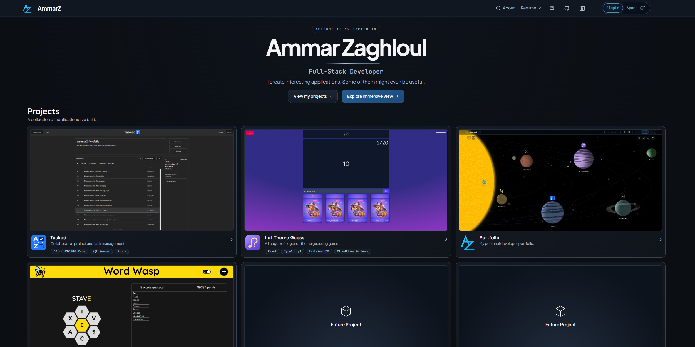

# About

My personal portfolio, featuring an informative, sleek, and professional layout. If that doesn't seem much more interesting than going through a README, it also features an immersive, animated and even customizable layout that's definitely a lot more interesting than just reading this. 

Visit the portfolio at [ammarz.com](https://ammarz.com)

If you want to skip to the fun part go to [ammarz.com/#space](https://ammarz.com/#space)

## Features

- A simple layout consisting of a gallery with project cards and preview images
- An interactive layout consisting of a procedurally generated solar system with planets corresponding to each project.
- A detailed project view with a description, more example images, and the stack
- Links to all my projects and my resume
- Some hints about future projects...

## Built with

React, TypeScript, Vite, and Vanilla CSS. Hosted on Cloudflare.

The solar system layout

The simple layout
